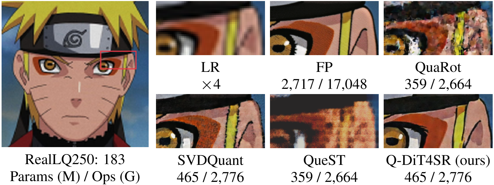
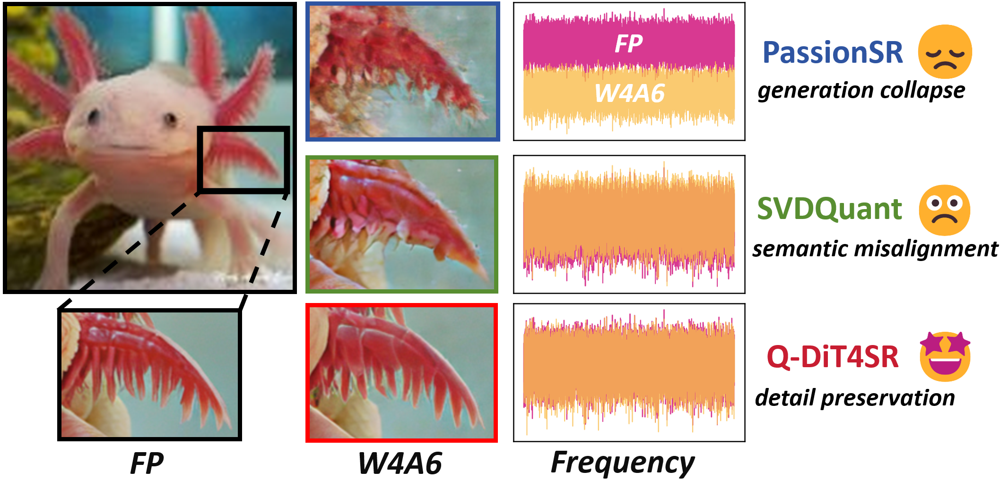
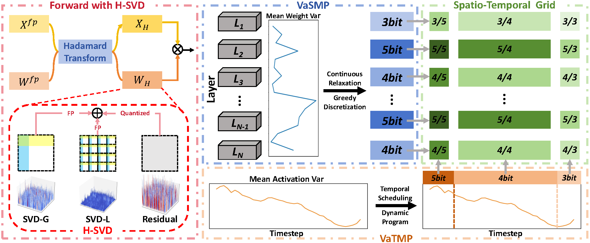
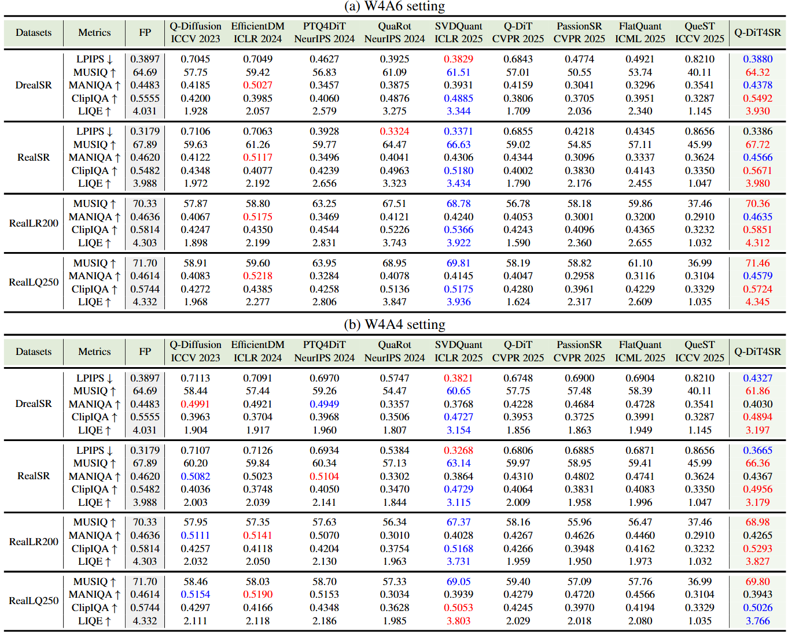
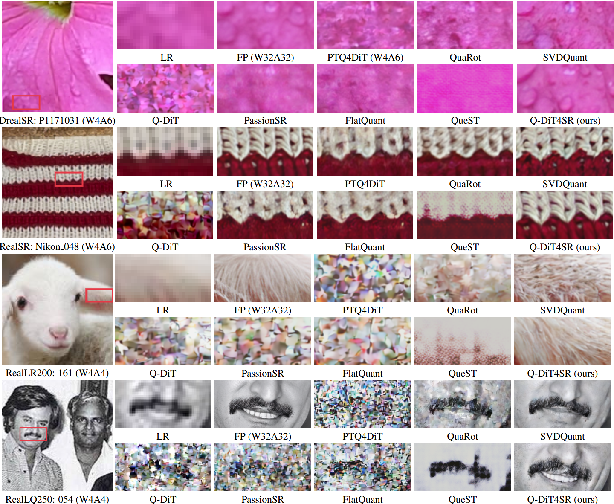

<div align="center">
<p align="center">  </p>
</div>

# 🚀 Q-DiT4SR: Exploration of Detail-Preserving Diffusion Transformer Quantization for Real-World Image Super-Resolution

<p align="center">
  <a href="https://xunzhang1128.github.io/">Xun Zhang</a><sup>1</sup>,
  <a href="https://github.com/racoonykc">Kaicheng Yang</a><sup>1</sup>,
  <a href="https://github.com/Lukebird17">Hongliang Lu</a><sup>1</sup>,
  <a href="https://github.com/htqin">Haotong Qin</a><sup>2</sup>,
  <a href="https://github.com/guoyongcs">Yong Guo</a><sup>3</sup>,
  <a href="https://github.com/yulunzhang"><b>Yulun Zhang</b></a><sup>1</sup>
</p>

<p align="center">
  <sup>1</sup>Shanghai Jiao Tong University &nbsp;&nbsp;
  <sup>2</sup>ETH Zurich &nbsp;&nbsp;
  <sup>3</sup>Huawei
</p>

<div align="center">
  <a href="https://arxiv.org/abs/2602.01273" target="_blank" style="text-decoration: none;"></a>
  <a href="https://github.com/xunzhang1128/Q-DiT4SR/releases/download/v1/Supplementary_Material.pdf" target="_blank" style="text-decoration: none;"></a>
  <a href="https://github.com/xunzhang1128/Q-DiT4SR/releases/tag/models-v1" target="_blank" style="text-decoration: none;"></a>
  <!-- Keep the historical page_id to preserve the accumulated visitor count. -->
  <a href="https://github.com/xunzhang1128/Q-DiT4SR" target='_blank' style="text-decoration: none;"></a>
  <a href="https://github.com/xunzhang1128/Q-DiT4SR/releases" target='_blank' style="text-decoration: none;"></a>
  <a href="https://github.com/xunzhang1128/Q-DiT4SR/stargazers" target='_blank' style="text-decoration: none;"></a>
</div>

---
## 🔥🔥🔥 News

- [**2026-01-31**] Repository initial release.
- [**2026-05-01**] Our paper has been accepted to **ICML 2026**! 🎉🎉🎉
- [**2026-10-14**] We release quantization, calibration, inference and evaluation code, W4A4/W4A6 checkpoints, and the calibration set. 🌈🌈🌈

### ⭐⭐⭐ If Q-DiT4SR is helpful to your projects, please help star this repo. Thanks!
---

## 📘 Abstract

> Recently, Diffusion Transformers (DiTs) have emerged in Real-World Image Super-Resolution (Real-ISR) to generate high-quality textures, yet their heavy inference burden hinders real-world deployment. While Post-Training Quantization (PTQ) is a promising solution for acceleration, existing methods in super-resolution mostly focus on U-Net architectures, whereas generic DiT quantization is typically designed for text-to-image tasks. Directly applying these methods to DiT-based super-resolution models leads to severe degradation of local textures. Therefore, we propose **Q-DiT4SR**, the first PTQ framework specifically tailored for DiT-based Real-ISR. We propose **H-SVD**, a hierarchical SVD that integrates a global low-rank branch with a local block-wise rank-1 branch under a matched parameter budget. We further propose **V**ariance-**a**ware **S**patio-**T**emporal **M**ixed Precision: **VaSMP** allocates cross-layer weight bit-widths in a data-free manner based on rate-distortion theory, while **VaTMP** schedules intra-layer activation precision across diffusion timesteps via dynamic programming (DP) with minimal calibration. Experiments on multiple real-world datasets demonstrate that our Q-DiT4SR achieves SOTA performance under both **W4A6** and **W4A4** settings. Notably, the W4A4 quantization configuration reduces model size by **5.8**$\times$ and computational operations by **6.14**$\times$.





---

## 📝 Overview



---

## 🔖 TODO

- ✅ Release model checkpoints.
- ✅ Release quantization, calibration, inference and evaluation code.
- ✅ Release calibration set.

---

## ⚙️ Installation

Use Linux, Python 3.8 and PyTorch 2.1.2 with CUDA 12.1. Building the Hadamard extension requires a compatible CUDA toolkit with `nvcc` in `PATH`. Run commands from the repository root and choose a new output directory for each run.

```bash
conda env create -f environment.yml
conda activate qdit4sr
python -m pip install -e .
python -m pip install packaging ninja wheel
python -m pip install fast-hadamard-transform==1.0.4.post1 --no-build-isolation
export OMP_NUM_THREADS=4
export MKL_NUM_THREADS=4
export PYTORCH_CUDA_ALLOC_CONF=max_split_size_mb:128
```

---

## 📦 Model Zoo

Download **[W4A4](https://github.com/xunzhang1128/Q-DiT4SR/releases/download/models-v1/qdit4sr-w4a4.tar.gz)** or **[W4A6](https://github.com/xunzhang1128/Q-DiT4SR/releases/download/models-v1/qdit4sr-w4a6.tar.gz)** from [GitHub Releases](https://github.com/xunzhang1128/Q-DiT4SR/releases/tag/models-v1). [SHA256SUMS](https://github.com/xunzhang1128/Q-DiT4SR/releases/download/models-v1/SHA256SUMS) provides download checksums. Extract the downloaded archive under `models/`:

```bash
mkdir -p models
tar -xzf qdit4sr-w4a4.tar.gz -C models
# For W4A6, use qdit4sr-w4a6.tar.gz instead.
```

Each model includes its weights and required JSON metadata. W4A4 also includes `activation_schedule.csv`; W4A6 uses uniform A6. See [Inference](#-inference) for loading commands.

The implementation uses FP16 simulated quantization. Download the upstream components below into `../Q-DiT4SR_workspace/models/`.

Download the required [SD3.5 Medium](https://huggingface.co/stabilityai/stable-diffusion-3.5-medium) VAE and text components after accepting its model terms:

```bash
huggingface-cli login
python - <<'PY'
from huggingface_hub import snapshot_download
snapshot_download(
    repo_id="stabilityai/stable-diffusion-3.5-medium",
    revision="b940f670f0eda2d07fbb75229e779da1ad11eb80",
    local_dir="../Q-DiT4SR_workspace/models/stable-diffusion-3.5-medium",
    allow_patterns=["scheduler/scheduler_config.json", "vae/config.json", "vae/*.safetensors",
                    "text_encoder*/config.json", "text_encoder*/*.safetensors",
                    "text_encoder*/*.safetensors.index.json", "tokenizer*/*"],
)
PY
```

For automatic captions, also download LLaVA and CLIP. Alternatively, pass `--captions <captions.json>` to use existing captions.

```bash
huggingface-cli download liuhaotian/llava-v1.5-13b --local-dir ../Q-DiT4SR_workspace/models/llava-v1.5-13b --include '*.json' '*.model' 'pytorch_model*.bin'
huggingface-cli download openai/clip-vit-large-patch14-336 --local-dir ../Q-DiT4SR_workspace/models/clip-vit-large-patch14-336 --include config.json preprocessor_config.json pytorch_model.bin
```

---

## 📂 Data Preparation

Following [DiT4SR](https://github.com/Adam-duan/DiT4SR), download RealSR, DrealSR and RealLR200 from [SeeSR's test datasets](https://drive.google.com/drive/folders/1L2VsQYQRKhWJxe6yWZU9FgBWSgBCk6mz), and RealLQ250 from [DreamClear](https://drive.google.com/file/d/16uWuJOyGMw5fbXHGcl6GOmxYJb_Szrqe/view). Arrange them under `../Q-DiT4SR_workspace/data/`:

```text
RealSR/{test_LR,test_HR}/
DrealSR/{test_LR,test_HR}/
RealLR200/
RealLQ250/lq/
inputs/                     Custom LR images
```

Paired LR/HR files must share filename stems and have ×4 dimensions. For calibration, place 32 RGB 128×128 crops from [RealSR V3](https://github.com/csjcai/RealSR) in `data/calibration/`.

---

## 🔧 Quantization

The released models can be used directly. To quantize a model yourself, first download the quality-oriented `dit4sr_q` Transformer from [DiT4SR](https://huggingface.co/acceptee/DiT4SR):

```bash
python - <<'PY'
import shutil
from pathlib import Path
from huggingface_hub import hf_hub_download
destination = Path("../Q-DiT4SR_workspace/models/dit4sr/transformer")
destination.mkdir(parents=True, exist_ok=True)
for name in ("config.json", "diffusion_pytorch_model.safetensors"):
    source = hf_hub_download("acceptee/DiT4SR", "dit4sr_q/transformer/" + name,
                            revision="d8603cec2fee0e8d5a502840b09439f7b168c31c")
    shutil.copy2(source, destination / name)
PY
```

Generate weight allocation using either released model's metadata to preserve the layer order:

```bash
QUANT_DIR=../Q-DiT4SR_workspace/quantization
MODEL_DIR=models/w4a4  # Or models/w4a6.
CUDA_VISIBLE_DEVICES=0 qdit4sr stats --weight-bits "$MODEL_DIR/quantization.json" --output "$QUANT_DIR/statistics"
qdit4sr allocate --statistics "$QUANT_DIR/statistics/weight_statistics.csv" --output "$QUANT_DIR/weights"
```

For W4A4, calibrate activations and generate a schedule. W4A6 skips this step:

```bash
CUDA_VISIBLE_DEVICES=0 qdit4sr act-stats --weight-bits "$QUANT_DIR/weights/weight_bits.csv" --calibration-canon data/calibration --calibration-seed 42 --output "$QUANT_DIR/calibration"
qdit4sr schedule --statistics "$QUANT_DIR/calibration/activation_statistics.csv" --weight-bits "$QUANT_DIR/weights/weight_bits.csv" --output "$QUANT_DIR/activation"
```

Export the desired setting:

```bash
CUDA_VISIBLE_DEVICES=0 qdit4sr export --setting w4a4 --weight-bits "$QUANT_DIR/weights/weight_bits.csv" --activation-schedule "$QUANT_DIR/activation/activation_schedule.csv" --seed 2026 --output "$QUANT_DIR/w4a4"
CUDA_VISIBLE_DEVICES=0 qdit4sr export --setting w4a6 --weight-bits "$QUANT_DIR/weights/weight_bits.csv" --seed 42 --output "$QUANT_DIR/w4a6"
```

Calibration accepts `--captions <calibration-captions.json>` to reuse captions. Load an exported folder with `--quantized-model`; for W4A4, also pass its generated CSV with `--activation-schedule`.

---

## 🖼️ Inference

Place LR images in `../Q-DiT4SR_workspace/data/inputs/` and prepare the models in [Model Zoo](#-model-zoo). Run the command for your downloaded setting on one visible GPU. These examples generate captions automatically:

```bash
INPUT_DIR=../Q-DiT4SR_workspace/data/inputs
ACTIVATION_SCHEDULE=models/w4a4/activation_schedule.csv
CUDA_VISIBLE_DEVICES=0 qdit4sr infer --quantized-model models/w4a4 \
  --activation-schedule "$ACTIVATION_SCHEDULE" \
  --input "$INPUT_DIR" --seed 42 --output outputs/custom-w4a4
CUDA_VISIBLE_DEVICES=0 qdit4sr infer --quantized-model models/w4a6 \
  --input "$INPUT_DIR" --seed 42 --output outputs/custom-w4a6
```

To use existing captions and skip LLaVA/CLIP, create `captions.json` with an entry for each input filename. For example:

```json
{
  "example.png": "A building with windows and trees beside the street."
}
```

Use the actual filenames in your input folder. Start with the first three sorted images using `--limit 3`:

```bash
CUDA_VISIBLE_DEVICES=0 qdit4sr infer --quantized-model models/w4a4 \
  --activation-schedule "$ACTIVATION_SCHEDULE" \
  --input "$INPUT_DIR" --captions "$INPUT_DIR/captions.json" \
  --seed 42 --limit 3 --output outputs/custom-w4a4-captions
```

Remove `--limit 3` to process the entire folder. Outputs include ×4 PNGs in `sr/`, `captions.json`, `rng_states.pt` and `inference.json`. For W4A4, use the bundled activation schedule or replace `ACTIVATION_SCHEDULE` with a CSV from [Quantization](#-quantization).

To repeat the caption-based run, reuse both its captions and RNG:

```bash
CUDA_VISIBLE_DEVICES=0 qdit4sr infer --quantized-model models/w4a4 \
  --activation-schedule "$ACTIVATION_SCHEDULE" \
  --input "$INPUT_DIR" --captions outputs/custom-w4a4-captions/captions.json \
  --rng-state outputs/custom-w4a4-captions/rng_states.pt \
  --seed 42 --limit 3 --output outputs/custom-w4a4-replay
```

Keep the same model, input files, sorted sequence and visible GPU count. For W4A6, adapt its command above and use its own saved files.

---

## 📊 Evaluation

Run inference and evaluation together on a benchmark:

```bash
ACTIVATION_SCHEDULE=models/w4a4/activation_schedule.csv
CUDA_VISIBLE_DEVICES=0 qdit4sr run --quantized-model models/w4a4 --activation-schedule "$ACTIVATION_SCHEDULE" --benchmark RealSR --seed 42 --output outputs/evaluation/RealSR-w4a4
```

To evaluate existing SR images instead:

```bash
CUDA_VISIBLE_DEVICES=0 qdit4sr evaluate --benchmark RealSR --sr outputs/evaluation/RealSR-w4a4/sr --gt ../Q-DiT4SR_workspace/data/RealSR/test_HR --output outputs/evaluation/RealSR-w4a4-metrics
```

Use `--benchmark DrealSR`, `RealLR200` or `RealLQ250` for the other datasets. For W4A6, use `--quantized-model models/w4a6` and omit `--activation-schedule`. RealSR/DrealSR compute LPIPS, MUSIQ, MANIQA, CLIP-IQA+ and LIQE; RealLR200/RealLQ250 compute the four no-reference metrics. Per-image scores and averages are written to `metrics.csv` and `summary.json`.

---

## <a name="results"></a>🔎 Results

We achieve SOTA Real-ISR performance on both W4A6 and W4A4 settings based on DiT backbones.

<details open>
<summary>Quantitative Results (click to expand)</summary>

- Results in Tab. 1 of the main paper

<p align="center">
  
</p>
</details>

<details open>
<summary>Qualitative Results (click to expand)</summary>

- Results in Fig. 6 of the main paper

<p align="center">
  
</p>
</details>

---

## <a name="citation"></a>📎 Citation

If you find the code helpful in your research or work, please cite the following paper.

```
@inproceedings{zhang2026qdit4sr,
  title={Q-DiT4SR: Exploration of Detail-Preserving Diffusion Transformer Quantization for Real-World Image Super-Resolution},
  author={Zhang, Xun and Yang, Kaicheng and Lu, Hongliang and Qin, Haotong and Guo, Yong and Zhang, Yulun},
  booktitle={Proceedings of the International Conference on Machine Learning (ICML)},
  year={2026}
}
```

---

## <a name="acknowledgements"></a>💡 Acknowledgements

We thank the developers of [DiT4SR](https://github.com/Adam-duan/DiT4SR) and [RobuQ](https://github.com/racoonykc/RobuQ) for their open-source contributions, which have greatly facilitated our research.
Powered by Stability AI. This repository retains the upstream [Pi-Lab License 1.0](LICENSE); SD3.5-derived weights also require the [Stability AI Community License](licenses/Stability-AI-Community.txt) and [NOTICE](NOTICE).
